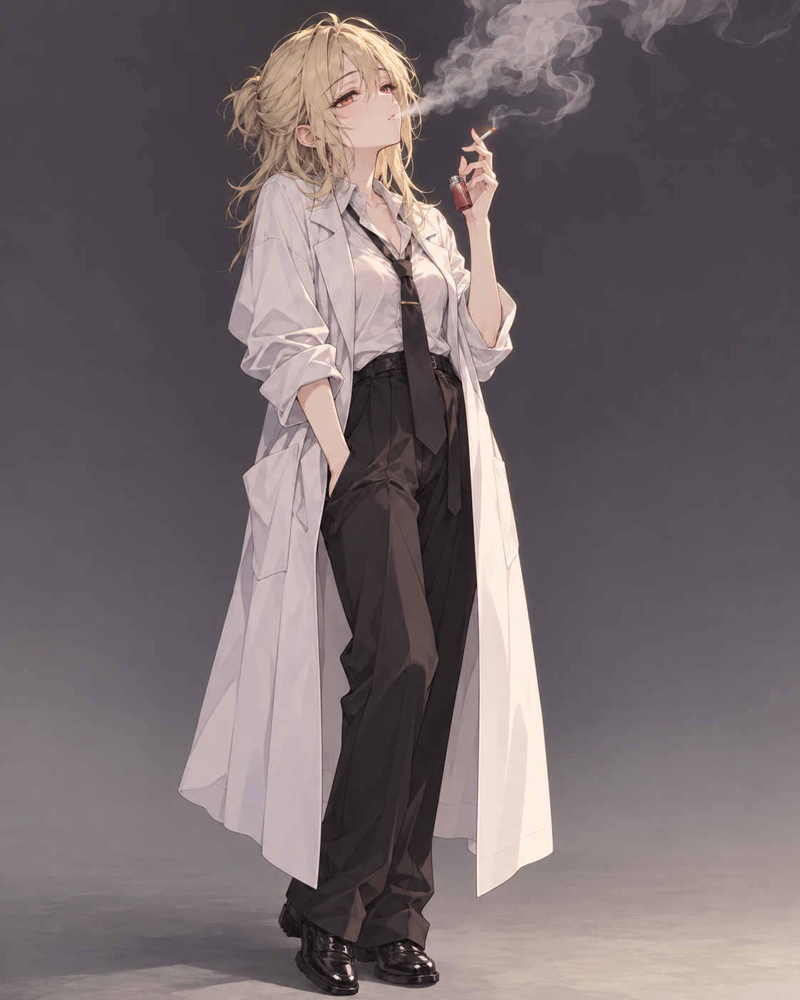
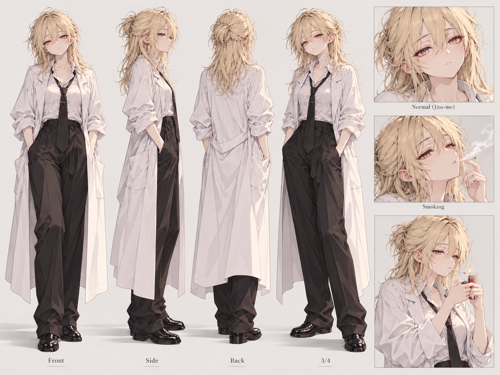
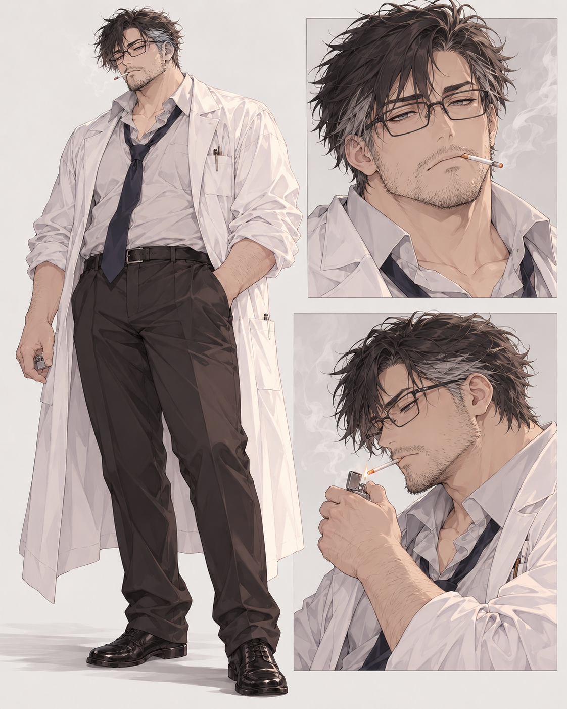
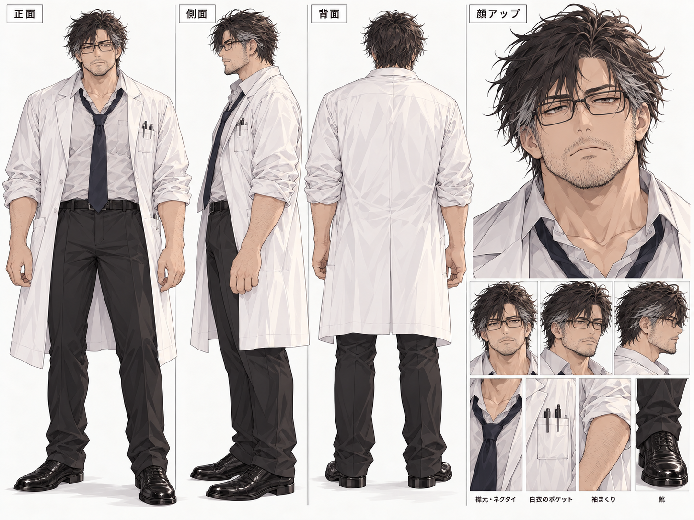

# SCPと一服

**正式タイトル：SCPと一服**（2026-10-13確定）。旧企画名「SCP財団 ヤニカス研究室」は現在の作品タイトルではありません。作中の「ヤニカス研究室」は職員間の通称として引き続き使用します。

**非公式SCP連作漫画の制作Workspace**。日本国内の小規模なSCPデータ解析研究室を舞台に、主任・七星（セッター）、新人・ゴールディ（バット）、現地情報を集めるエージェント・峰を描きます。いずれも非常に優秀な重度の愛煙家。基本は短編1Pですが、**第1話「新人歓迎」は2P**で制作します。

> **正式タイトルは「SCPと一服」に確定（独立したサブタイトルは設けない）**。旧ネームや当時の公開記録に残る旧題は歴史的表記として保存します。登場人物の本名の未指定部分、細部の外見、各話の展開、財団内での正式部署名・Site番号・権限は未決定です。SCP財団やSCP Wikiの公式企画ではありません。

## 作品の舞台

日本国内の小規模なSCPデータ解析研究室。主な仕事は**既存データの分析、異常性の研究、追加情報の収集**。大規模な実験室や専用収容設備は基本的に不要で、必要なら他部署と協力して実験し、研究員も現地調査へ出向きます。

研究室の隣に**専用喫煙室**があり、研究室への出入口には**エアシャワー**を設置。白衣等は洗浄・交換で清潔に保つ。研究室と喫煙区画は分離しています。詳細は[連載設定](series/README.md)を正本とします。

## 目次

- 📚 **[エピソード一覧・進捗表](episodes/README.md)** — 話数、題材、ネーム、画像、公開状態を管理する**唯一の一覧**
- 📖 [連載の構想・継続設定](series/README.md)
- 👤 [固定キャラクター・登場人物一覧](characters/README.md) — [バット画像参照](characters/CHAR-001_BAT_REFERENCE.md) ／ **[セッター画像参照](characters/CHAR-002_SETTER_REFERENCE.md)** ／ **[峰画像参照](characters/CHAR-003_MINE_REFERENCE.md)**
- 🧾 [原作クレジットとライセンス](CREDITS.md)
- 📝 [新しいエピソードの雛形](episodes/TEMPLATE.md) ／ **[SCPと一服：作画・pixiv投稿テンプレート](series/PIXIV_PUBLICATION_TEMPLATE.md)**
- 🧪 [実作品から抽出した制作回帰ケース](series/PRODUCTION_REGRESSION_CASES.md) — 参照画像、RTL文字、原作整合、生成画像の採否を検証

## 固定キャラクターの基準画像

<a href="characters/CHAR-001_BAT.md"></a>

[ゴールディ（バット） — Character Sheet v1.0](characters/CHAR-001_BAT.md) ／ [基準画像PNG](characters/assets/CHAR-001_BAT_reference-v1.png)

### 角度別リファレンス（三面図・表情）

<a href="characters/assets/CHAR-001_BAT_turnaround-v1.png"></a>

[三面図・表情差分の原寸PNG](characters/assets/CHAR-001_BAT_turnaround-v1.png) ／ [画像生成向け運用ルール](characters/CHAR-001_BAT_REFERENCE.md)

※ **v1単体立ち絵が顔・髪・衣装の正本**。この三面図は角度と表情の補助参照です。

### CHAR-002 — 七星（セッター）

- **[設定・採用画像の固定条件（キャラクターシート v1.0）](characters/CHAR-002_SETTER.md)**
- **[生成用ショートリファレンス](characters/CHAR-002_SETTER_REFERENCE.md)**

40代前半、約190cm・100kg、熊のような大柄な主任研究員。無精髭・眼鏡・緩い濃紺ネクタイ・ジッポ。**採用済み基準画像と三面図のPNGをGitHubに登録済み**。

<a href="characters/CHAR-002_SETTER.md"></a>

[基準画像PNG](characters/assets/CHAR-002_SETTER_reference-v1.png)

<a href="characters/assets/CHAR-002_SETTER_turnaround-v1.png"></a>

[三面図・顔アップPNG](characters/assets/CHAR-002_SETTER_turnaround-v1.png) ／ [画像生成時の参照ルール](characters/CHAR-002_SETTER_REFERENCE.md)

※ 新しい三面図は補助参照。顔・体格・衣装の正本は採用済み基準画像と確定設定です。

### CHAR-003 — 峰（ミネ）

- **[キャラクターシート v1.0（設定と採用前の暫定細部）](characters/CHAR-003_MINE.md)**
- **[画像生成用ショートリファレンス](characters/CHAR-003_MINE_REFERENCE.md)**

40歳前後、細目・垂れ目・柔らかい体つき、ブラウス・スカート・低いヒール。潜入・調査・情報収集に秀でた**非戦闘型エージェント**。ルートにアップされた人物参照・喫煙参照の2枚を整理済み。

<a href="characters/CHAR-003_MINE.md"></a>

[人物・衣装の基準参照PNG](characters/assets/CHAR-003_MINE_reference-v1.png)

<a href="characters/assets/CHAR-003_MINE_smoking-v1.png"></a>

[喫煙時リファレンスPNG](characters/assets/CHAR-003_MINE_smoking-v1.png)

※ **人物画像を同一性の第一参照、喫煙画像を状態差分の補助参照**とする。ユーザー指定以外の画像細部は未確定。

## 公開済みエピソード

**[EP012 — SCP-2148-JP「喫煙治療計画」](episodes/EP012_SCP-2148-JP/README.md)** — **2026-10-22 pixiv公開済み（作者報告）・全5P**。[公開作品](https://www.pixiv.net/artworks/151120131)／[完成原稿5P](episodes/EP012_SCP-2148-JP/images/README.md)／[公開記録](episodes/EP012_SCP-2148-JP/PUBLICATION.md)／[文章ネーム](episodes/EP012_SCP-2148-JP/name/PUBLISHED_NOTES.md)。

**[EP012 幕間「銘柄不明」](episodes/EP012_SCP-2148-JP/interlude/README.md)** — **2026-10-22 pixiv公開済み（作者報告）・カラー1P**。[公開作品](https://www.pixiv.net/artworks/151138375)／[完成原稿](episodes/EP012_SCP-2148-JP/interlude/images/final/P001.png)／[公開ネーム](episodes/EP012_SCP-2148-JP/interlude/name/P001.md)／[公開記録](episodes/EP012_SCP-2148-JP/interlude/PUBLICATION.md)。

**[EP011 — SCP-3001「レッド・リアリティ」](episodes/EP011_SCP-3001/README.md)** — 2026-10-20 pixiv公開済み（作者報告）。[公開作品](https://www.pixiv.net/artworks/151086265)／[完成原稿6P](episodes/EP011_SCP-3001/images/README.md)／[公開記録](episodes/EP011_SCP-3001/PUBLICATION.md)。

**[EP009 — SCP-1641-JP「ノスタルジア☆コーヒーメーカー」](episodes/EP009_SCP-1641-JP/README.md)** — 2026-10-19公開。[本編3P](https://www.pixiv.net/artworks/151036333)（[P001](episodes/EP009_SCP-1641-JP/images/final/P001.png)・[P002](episodes/EP009_SCP-1641-JP/images/final/P002.png)・[P003](episodes/EP009_SCP-1641-JP/images/final/P003.png)）＋[幕間1P](https://www.pixiv.net/artworks/151036388)（[完成画像](episodes/EP009_SCP-1641-JP/interlude/images/final/P001.png)）。[pixiv実投稿データ](episodes/EP009_SCP-1641-JP/PUBLICATION.md)／[幕間実投稿データ](episodes/EP009_SCP-1641-JP/interlude/PUBLICATION.md)／[原作クレジット](episodes/EP009_SCP-1641-JP/CREDITS.md)。


**[EP001 — SCP-403「新人歓迎」](episodes/EP001_SCP-403/README.md)** — **[pixiv公開済み（2026-10-12）](https://www.pixiv.net/artworks/150764451)**。

公開時のpixiv題名は**「SCP-403 段階的過熱ライター」**。2ページの完成原稿は[画像管理ページ](episodes/EP001_SCP-403/images/README.md)と[公開記録](episodes/EP001_SCP-403/PUBLICATION.md)から確認できます。

**[EP002 — SCP-9908「喫煙。」](episodes/EP002_SCP-9908/README.md)** — **[pixiv公開済み（2026-10-12）](https://www.pixiv.net/artworks/150784921)**。2ページ構成で、正式な第2話として2026-10-13に採番。[公開記録](episodes/EP002_SCP-9908/PUBLICATION.md)を参照。GitHubの候補PNGとpixiv掲載画像の同一性は未照合です。

**[EP003 — SCP-710-JP-J「財団神拳」](episodes/EP003_SCP-710-JP-J/README.md)** — **[pixiv公開済み（2026-10-13 19:11 JST）](https://www.pixiv.net/artworks/150809472)**。本編2ページの[完成原稿P001](episodes/EP003_SCP-710-JP-J/images/final/P001.png)・[P002](episodes/EP003_SCP-710-JP-J/images/final/P002.png)をGitHubに整理し、[公開記録](episodes/EP003_SCP-710-JP-J/PUBLICATION.md)も保存。シリーズ上は第4掲載作品ですが本編の正式番号は**EP003**。[幕間「現実だ」](episodes/EP003_SCP-710-JP-J/interlude/README.md)は[2026-10-14 pixiv公開済み](https://www.pixiv.net/artworks/150832515)。[完成原稿](episodes/EP003_SCP-710-JP-J/interlude/images/final/P001.png)・[公開記録](episodes/EP003_SCP-710-JP-J/interlude/PUBLICATION.md)を別枠で保存。

**[EP004 — 「財団と要注意団体」](episodes/EP004_GOI/README.md)** — **[pixiv公開済み（2026-10-14 13:21 JST）](https://www.pixiv.net/artworks/150837706)**。要注意団体の紹介をテーマとする本編全4ページ。ルート直下にアップロードされた4枚を[完成原稿P001〜P004](episodes/EP004_GOI/images/README.md)へBlob SHAそのままで整理済み。[pixiv実投稿と帰属の公開記録](episodes/EP004_GOI/PUBLICATION.md)を参照。資料内の酩酊街の文字表記などの[制作上の既知問題](episodes/EP004_GOI/images/README.md)も記録。

**[EP005 — SCP-024-JP「東弊カラオケ」](episodes/EP005_SCP-024-JP/README.md)** — **[pixiv公開済み（2026-10-15）](https://www.pixiv.net/artworks/150872458)**。4P完成原稿を[images/final](episodes/EP005_SCP-024-JP/images/README.md)へSHA維持で整理済み。[pixiv実投稿情報](episodes/EP005_SCP-024-JP/PUBLICATION.md)を保存。**正式話数 EP005（2026-10-15採番）**。

**[EP006 — SCP-3491-JP「すくえない男」](episodes/EP006_SCP-3491-JP/README.md)** — [本編3ページ公開済み](https://www.pixiv.net/artworks/150912875)。さらに、**[幕間「師範の勘」1ページ](episodes/EP006_SCP-3491-JP/interlude/README.md)**も[2026-10-16にpixiv公開済み](https://www.pixiv.net/artworks/150922208)。[幕間完成原稿](episodes/EP006_SCP-3491-JP/interlude/images/final/P001.png)／[公開記録](episodes/EP006_SCP-3491-JP/interlude/PUBLICATION.md)。本編話数はEP006のまま。

**[EP005 幕間「実験記録」](https://www.pixiv.net/artworks/150875995)** — **2026-10-15公開・1P**。[完成原稿](episodes/EP005_SCP-024-JP/interlude/images/final/P001.png)／[公開記録](episodes/EP005_SCP-024-JP/interlude/PUBLICATION.md)／[制作Workspace](episodes/EP005_SCP-024-JP/interlude/README.md)。本編と別管理。

**[EP004 幕間 — サメ殴りセンター「スカウト」](https://www.pixiv.net/artworks/150850704)** — **2026-10-14 pixiv公開済み（ユーザー報告）**。1P完成原稿を[幕間Workspace](episodes/EP004_GOI/interlude/README.md)へ整理。[完成PNG](episodes/EP004_GOI/interlude/images/final/P001.png)／[公開記録](episodes/EP004_GOI/interlude/PUBLICATION.md)。本編EP004の4Pには加算しない。

**[EP002 幕間 — SCP-9908「翌朝」](https://www.pixiv.net/artworks/150797153)** — **[pixiv公開済み（2026-10-13）](https://www.pixiv.net/artworks/150797153)**。1ページの後日談、シリーズの第3掲載作品。[pixiv実投稿の公開記録](episodes/EP002_SCP-9908/interlude/PUBLICATION.md)には実際の説明文全文とタグを保存。[完成原稿PNG](episodes/EP002_SCP-9908/interlude/images/final/P001.png)と[文章ネーム](episodes/EP002_SCP-9908/interlude/name/P001.md)も同じWorkspaceに整理済み。

[「SCPと一服」第1話の2P作画とpixiv投稿を次回に生かすテンプレート](series/PIXIV_PUBLICATION_TEMPLATE.md)を作成しました。コマ割りや色を毎回固定するものではありません。

以前のSCP-650案は[不採用の初期草稿](episodes/EP001_SCP-650/README.md)として残しています。

## ディレクトリ

```text
scp-manga-works/
├── AGENTS.md                    # AI制作・更新ルール
├── README.md                    # 作品の入口
├── CREDITS.md                   # 権利表記の入口
├── series/README.md             # 世界観・連載の方向性
├── characters/README.md         # 固定人物の一覧
├── characters/CHAR-003_MINE.md  # 峰の設定と画像
├── characters/CHAR-003_MINE_REFERENCE.md  # 峰の生成用参照
├── characters/assets/CHAR-003_MINE_reference-v1.png  # 峰の人物参照
├── characters/assets/CHAR-003_MINE_smoking-v1.png    # 峰の喫煙参照
├── series/PIXIV_PUBLICATION_TEMPLATE.md             # 作画・pixiv公開の参考
└── episodes/
    ├── README.md                # 話数一覧（正本）
    ├── TEMPLATE.md              # 新話の記録用雛形
    ├── EP001_SCP-403/
    │   ├── README.md            # 公開済み第1話
    │   ├── PUBLICATION.md       # 公開作品情報・学び
    │   ├── CREDITS.md           # SCP-403 原作・出典
    │   ├── name/P001.md/P002.md # 文章ネーム（草稿）
    │   └── images/final/
    │       ├── P001.png         # 公開原稿
    │       └── P002.png         # 公開原稿
    ├── EP002_SCP-9908/          # 公開済み第2話
    │   ├── README.md            # 制作・状態
    │   ├── PUBLICATION.md       # pixiv公開情報
    │   ├── name/P001.md/P002.md # 改訂文章ネーム
    │   ├── images/drafts/       # 本編の未採用候補PNG2枚
    │   └── interlude/           # SCP-9908幕間「翌朝」
    │       ├── name/P001.md     # 幕間の制作ネーム
    │       ├── PUBLICATION.md   # pixivの実投稿（正本）
    │       ├── images/README.md # 画像の来歴
    │       └── images/final/P001.png # 幕間の完成原稿
    ├── EP003_SCP-710-JP-J/     # 公開済み第3話、本編2P
    │   ├── name/P001.md/P002.md # 制作ネーム履歴
    │   ├── images/final/        # 採用完成原稿2P
    │   ├── PUBLICATION.md       # pixiv実投稿の正規記録
    │   └── interlude/name/P001.md # 未公開幕間
    ├── EPXXXX_SCP-4999/         # 話数未確定の試作
    └── EP001_SCP-650/           # 不採用の旧草稿
```

画像は生成した段階で、各話の `images/drafts/`（生成候補）または `images/final/`（採用済み完成版）に追加します。

## 1話を追加するとき

1. `EP###_SCP-xxx`（次の正式話数）などのフォルダを作り、`episodes/TEMPLATE.md` を参考に各話 `README.md` を置く。
2. 文章ネームを `name/P001.md` に書く。1P目は `P001`、2P目は `P002`。
3. 生成した候補PNGを `images/drafts/P001-v01.png` のように保存する。不要な試行画像はGitへ追加しない。
4. レビュー済みの採用画像だけを `images/final/P001.png` に保存する。
5. **`episodes/README.md` の一覧を更新**し、原作クレジットと各話ステータスを照合する。

## 制作ルール

**標準工程は「SCP原典・人物参照確認 → 文章ネーム → 1ページずつ画像生成 → 実画像レビュー → 必要箇所の修正 → 採用・公開」です。** 綴理コアの現在の漫画制作Skillを用い、日本語ページ漫画は原則右→左・縦書きとします。吹き出し本体と尻尾の話者、人物の左右位置、煙草や手指などの連続性、情報量を完成画像で確認します。

[Manga Blueprint Studio](https://github.com/c-a-p-engineer/manga-blueprint-studio) のBlueprint作成・コンパイルは**通常工程から除外**しました。厳密なレイアウト固定や再現性を必要とする作品、または明示指定がある場合のみ任意で使用します。以前のBlueprintや画像・ネームは削除せず履歴として保持します。Studioのコードや練習用fixtureはこのRepositoryに置きません。

### 画像容量

PNGは1枚約2MBを想定。当面は**完成原稿と残す価値のある生成候補だけ**をGitで管理します。例：100話×完成PNG1枚なら画像本体は約200MBですが、改稿・追加候補・Git履歴で増えます。容量が問題になってから保管先を再検討し、安易に全画像をGit LFSへ移行しません。

## ライセンス・出典

本プロジェクトのSCP由来の漫画・文章は、原作の著者と出典を表示し、**Creative Commons Attribution-ShareAlike 3.0 (CC BY-SA 3.0)** に基づいて提供します。各話の `CREDITS.md` も確認してください。SCPの原作記事と画像素材は権利条件を混同せず個別に確認します。

- [SCP Wiki](https://scp-wiki.wikidot.com/)
- [SCP Licensing Guide](https://scp-wiki.wikidot.com/licensing-guide)
- [CC BY-SA 3.0](https://creativecommons.org/licenses/by-sa/3.0/)
