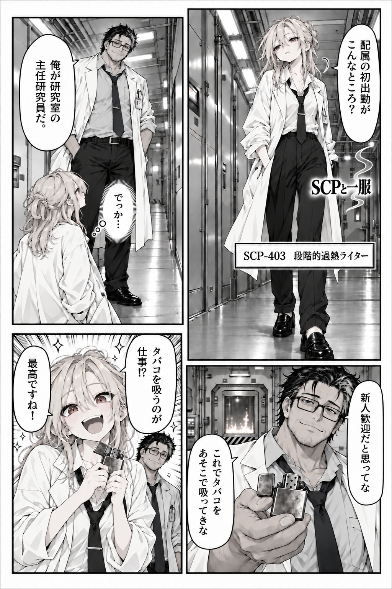
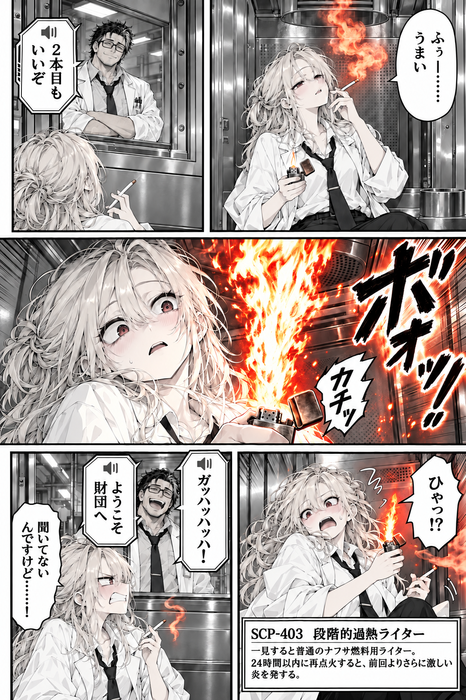

# EP001 SCP-403 — 画像管理

**2ページともpixiv公開済み、GitHubの原稿保存が完了しています。**

| ページ | 画像 | 内容 | 元のGit Blob SHA | サイズ |
| --- | --- | --- | --- | ---: |
| P001 | [final/P001.png](final/P001.png) | 通路での配属初日、ゴールディとセッターの初対面 | `d5c00f5b94f0c44023aabac6594b73a567ff060c` | 2,347,636 bytes |
| P002 | [final/P002.png](final/P002.png) | 耐火試験室、2本目、赤い炎、七星の笑いとSCP説明 | `80c0d26bf35e098139707405c98bf857e6bb1d2b` | 2,804,602 bytes |

## 公開原稿プレビュー

### P001

### P002

- 2026-10-12、ユーザーがルートにアップロードした2つのPNGの**ページ順と中身を目視で確認**後、Git Blob SHAを変更せず `images/final/` に移動した。
- **GitHubに保存したPNGとpixiv配信画像のバイナリ同一性は未検証**。公開版の原稿資料として扱う。
- `images/drafts/` には今後の差分・制作途中候補だけを保存する。既存の旧草稿ネームは `name/` に残す。
- これらの漫画画像をキャラクター設定の正本にせず、人物外見は `characters/` のCharacter Sheetと承認済みリファレンスPNGを正本とする。

[制作Workspace](../README.md) ／ [公開記録](../PUBLICATION.md) ／ [P001ネーム草稿](../name/P001.md) ／ [P002ネーム草稿](../name/P002.md)
